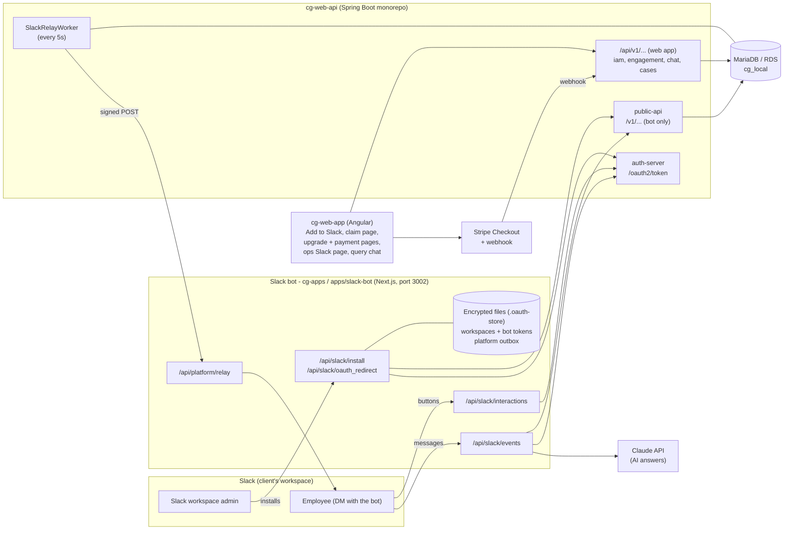
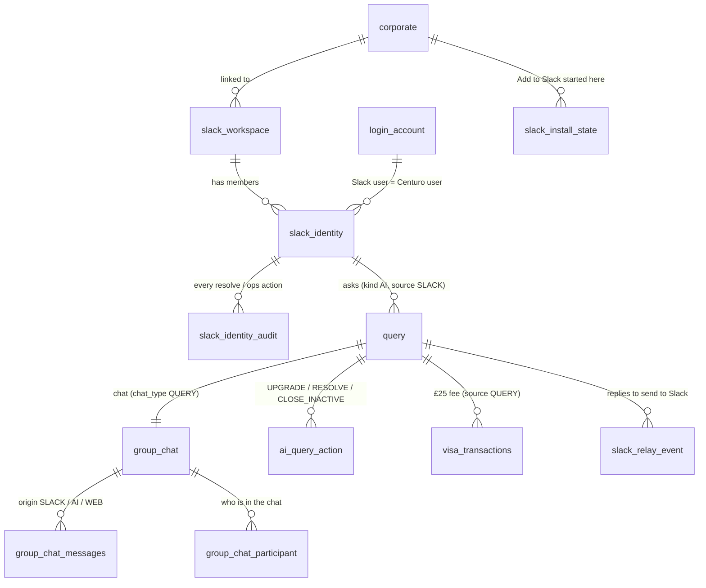
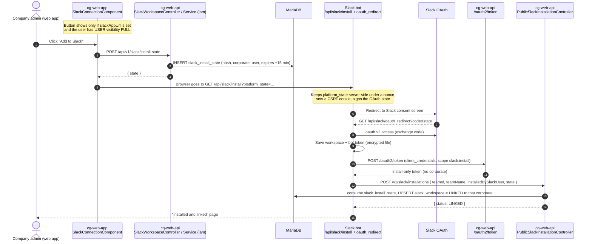
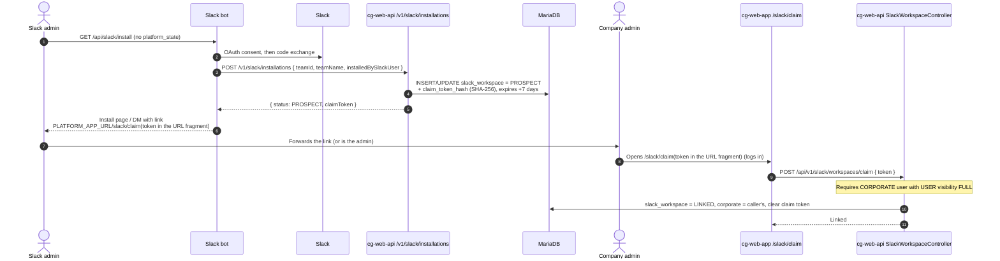
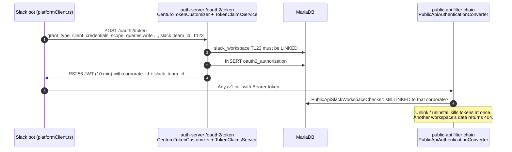
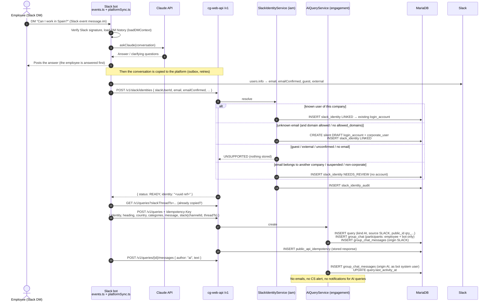
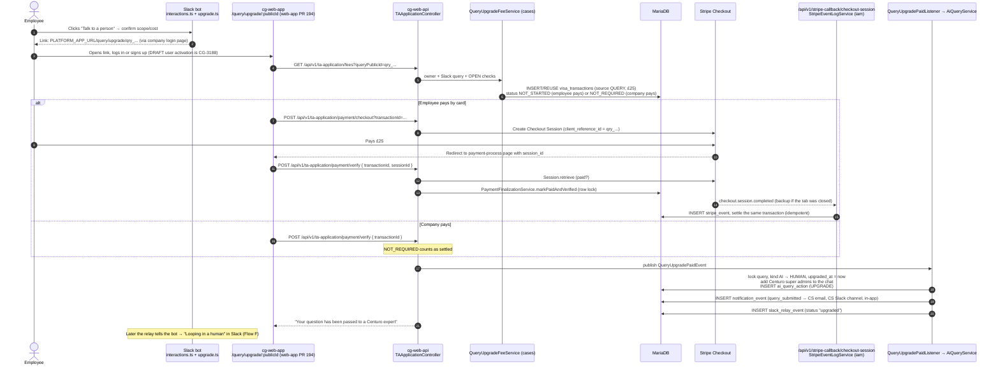
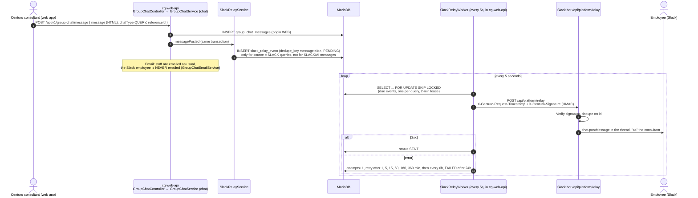
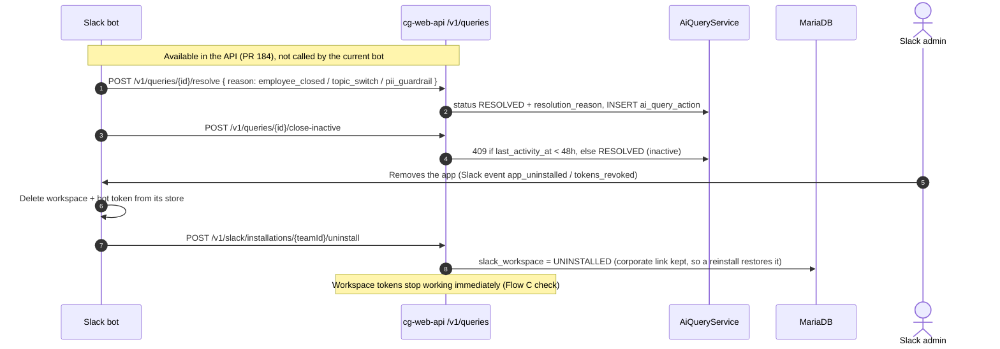

# Slack bot: how it works, end to end

This explains the whole Slack bot feature (cg-web-api stack #187, plus the bot and web-app PRs it depends on): every flow from the **"Add to Slack"** button to the expert reply arriving back in Slack. For each step it shows which API is called, which code handles it, and what gets stored where.

**Start with section 0.** It walks through every scenario in plain language, as a story. Sections 1–9 then show the same flows technically (APIs, code, tables), and section 10 marks where each issue found in the review sits.

> The diagrams are Mermaid. They display as diagrams on GitHub, in VS Code (Markdown preview with Mermaid support) and on mermaid.live.
> Everything here was taken from the code at the top of each branch:
> - cg-web-api: `feature/CG-3179-query-escalation-payment`
> - cg-apps: `feat/slack-bot/import`
> - cg-web-app: `feature/CG-3187-slack-link`, plus `feature/CG-3179-query-escalation-payment` for the payment pages

---

## 0. The whole thing as a story (start here)

### The cast

| Who | Role |
|---|---|
| **Acme Ltd** | A Centuro client company |
| **Hannah** | Acme's HR admin. She has a Centuro login with full access to Acme's users |
| **Priya** | An Acme employee. She uses Slack every day and may never have logged into Centuro |
| **Tom** | A contractor from another firm who is a member of Acme's Slack |
| **The bot** | "Centuro" in Slack: the Slack app in cg-apps |
| **The platform** | Centuro's backend (cg-web-api) and website (cg-web-app) |
| **Sarah** | A Centuro consultant who answers questions in the Centuro web app |
| **Ops** | Centuro's back-office team |

Two ideas make the rest easier:
- **The bot does the chatting, and the platform keeps the records.** The bot answers Priya in Slack, and quietly copies the conversation to the platform, so Centuro has the history and can take over if needed.
- **The platform never talks to Slack directly.** When Centuro has something to say to Priya, it hands the message to the bot, and the bot posts it in Slack.

---

### Scenario 1: Acme connects its Slack from the Centuro website

*Hannah wants her team to be able to ask Centuro questions in Slack.*

1. Hannah logs into the Centuro website and clicks **"Add to Slack"**.
   - The button only shows if the Slack feature is set up, and only for admins like Hannah.
2. Behind the scenes, the website asks the platform for a **one-time ticket** saying "this install is for Acme". The ticket lasts 15 minutes and can be used only once.
3. Hannah's browser goes to the bot, carrying the ticket. The bot holds on to it and sends Hannah to **Slack's own permission screen**: "Centuro wants to post messages, read DMs sent to it, see users' emails…"
4. Hannah clicks **Allow**. Slack sends her back to the bot with proof of approval, and the bot swaps that for its own **Slack bot token** for Acme's workspace.
5. The bot saves that token (encrypted, on its side only), then tells the platform: *"I've been installed in Slack workspace T123, here's the ticket."*
6. The platform checks the ticket, marks it as used, and records: **Slack workspace T123 belongs to Acme, status LINKED**.
7. Hannah sees a page saying the bot is installed and connected to Acme.

**APIs called:**

| Step | Who calls | API call | Handled by |
|---|---|---|---|
| 1 | Website → platform | `POST /api/v1/auth/token` (Hannah's normal login) | iam auth |
| 2 | Website → platform | `POST /api/v1/slack/install-state` → `{ state, expiresAt }` | `SlackWorkspaceController` → `SlackWorkspaceService.issueInstallState` |
| 3 | Browser → bot | `GET /api/slack/install?platform_state=<state>` | bot `pages/api/slack/install.ts` |
| 3 | Bot → Slack | Redirect to `https://slack.com/oauth/v2/authorize?client_id=…&scope=…&state=…` | Slack |
| 4 | Slack → bot | `GET /api/slack/oauth_redirect?code=…&state=…` | bot `oauth_redirect.ts` → `lib/slackInstall.ts` |
| 4 | Bot → Slack | `oauth.v2.access` (swap the code for the bot token) | Slack Web API |
| 5 | Bot → platform | `POST /oauth2/token` (`grant_type=client_credentials`, `scope=slack:install`) | auth-server |
| 5 | Bot → platform | `POST /v1/slack/installations` `{ teamId, teamName, installedBySlackUser, state }` | `PublicSlackInstallationController` → `SlackWorkspaceService` |
| 6 | Platform → bot | Response `{ status: "LINKED", … }` | |

**What's saved:** the platform saves the workspace (`slack_workspace`, LINKED to Acme) and marks the one-time ticket as used (`slack_install_state`). The bot saves the Slack token in its own encrypted file.

**Can go wrong here:** the ticket isn't tied to *who* uses it, so a link sent to another company's Slack admin could connect *their* Slack to Acme (issue #6).

---

### Scenario 2: someone installs the bot straight from Slack, and Acme claims it later

*Someone in Acme's Slack finds the Centuro bot and installs it without going through the Centuro website.*

1. They click install and approve Slack's permission screen, as in Scenario 1, but **without a ticket**.
2. The bot tells the platform: *"I've been installed in workspace T123"*. The platform doesn't know which company that is yet.
3. The platform records the workspace as a **PROSPECT** (not linked to anyone) and creates a **claim link** that is valid for 7 days. It keeps only a scrambled copy of the link's code, so even the database can't be used to rebuild it.
4. The bot shows the installer the claim link: `…/slack/claim#token=…`.
5. The installer passes the link to Hannah. Hannah opens it, logs into Centuro and confirms.
6. The platform checks that Hannah is an admin, then links the workspace to Acme (**LINKED**) and deletes the claim code.

**Or ops do it:** Centuro ops can open the **Slack workspaces** admin page and link (or unlink) any workspace to a company by hand.

**APIs called:**

| Step | Who calls | API call | Handled by |
|---|---|---|---|
| 1 | Browser → bot | `GET /api/slack/install` (no `platform_state`), then Slack's authorize page | bot `install.ts` |
| 1 | Slack → bot, bot → Slack | `GET /api/slack/oauth_redirect?code=…`, then `oauth.v2.access` | bot `oauth_redirect.ts` |
| 2 | Bot → platform | `POST /oauth2/token` (`scope=slack:install`) | auth-server |
| 2–3 | Bot → platform | `POST /v1/slack/installations` `{ teamId, teamName, installedBySlackUser }` → `{ status: "PROSPECT", claimToken }` | `PublicSlackInstallationController` → `SlackWorkspaceService` |
| 4 | Bot → installer | Link `PLATFORM_APP_URL/slack/claim#token=<claimToken>` | bot `lib/slackInstall.ts` |
| 5 | Hannah | Opens the website's `/slack/claim` page, logs in (`POST /api/v1/auth/token`) | cg-web-app `SlackClaimComponent` |
| 6 | Website → platform | `POST /api/v1/slack/workspaces/claim` `{ token }` | `SlackWorkspaceController` → `SlackWorkspaceService.claim` |
| Ops | Website → platform | `GET /api/v1/admin/slack/workspaces` (list) | `AdminSlackWorkspaceController` |
| Ops | Website → platform | `PUT /api/v1/admin/slack/workspaces/{teamId}/corporate` `{ corporateId }` (link) | `AdminSlackWorkspaceController` |
| Ops | Website → platform | `DELETE /api/v1/admin/slack/workspaces/{teamId}/corporate` (unlink) | `AdminSlackWorkspaceController` |

**What's saved:** the workspace (`slack_workspace`), first as PROSPECT with a claim code, then LINKED to Acme.

**Can go wrong here:**
- Installing again creates a new claim link and breaks the old one.
- Ops can "link" a workspace where the app has been removed (Aniket #11).
- A suspended company can still be linked.

---

### Scenario 3: every time the bot talks to the platform, it proves which workspace it's working for

*This happens silently before every action in the scenarios below.*

1. The bot asks the platform for a short-lived pass (a **token**, valid for 10 minutes): *"I need to work for workspace T123."*
2. The platform checks that T123 is still **linked** to a company, and issues a pass that says *"bot, working for Acme, workspace T123"*.
3. The bot shows this pass on every request. Each time, the platform checks again that T123 is still linked. If Acme unlinked or removed the bot a second ago, the pass stops working.
4. The pass only gives access to **Acme's** data for **that** workspace. Asking for anything else gets "not found".

**APIs called:**

| Step | Who calls | API call | Handled by |
|---|---|---|---|
| 1–2 | Bot → platform | `POST /oauth2/token` with `grant_type=client_credentials`, `scope=queries:write queries:read slack-identities:write`, `slack_team_id=T123` (Basic auth with the bot's client id and secret) → a 10-minute JWT carrying `corporate_id` + `slack_team_id` | auth-server `CenturoTokenCustomizer` / `TokenClaimsService` |
| 3 | Bot → platform | Every `/v1/...` call carries `Authorization: Bearer <token>` | public-api `PublicApiAuthenticationConverter` + `PublicApiSlackWorkspaceChecker` (still linked?) |
| (optional) | Bot → platform | `GET /v1/slack/workspaces/{teamId}` (workspace + company name) | `PublicSlackWorkspaceController` |

**What's saved:** a record of each pass issued (`oauth2_authorization`). This table is never cleaned up.

**Can go wrong here:** the platform never checks whether **Acme itself has been suspended**. A suspended company's bot keeps working (reproduced).

---

### Scenario 4: Priya asks her first question

*Priya opens a DM with the bot: "Can I work from Spain for 3 months?"*

1. Slack sends the message to the bot. The bot checks it really came from Slack, then reads the earlier messages in that DM so it has the context.
2. The bot asks **Claude (the AI)** for an answer, or for clarifying questions, and **posts the reply to Priya straight away**. Priya is always answered first; copying to the platform happens afterwards.
3. Now the bot copies the conversation to the platform. First it needs to know **who Priya is in Centuro**. It asks Slack for Priya's profile (email, whether the email is confirmed, whether she's a guest), and sends that to the platform.
4. The platform decides who Priya is (see Scenario 5 for every outcome). Say Priya already has a Centuro account at Acme: she's **matched to that account**. The platform gives the bot an anonymous reference for her and doesn't say whether the account already existed.
5. The bot asks the platform to **create a query** for the conversation: a title and category (worked out by the AI), the first message, and which Slack thread it came from. The request carries a **"don't do this twice" key**, so a retry doesn't create a second query.
6. The platform creates:
   - a **query** marked as **AI** and from **Slack**, with a public ID like `qry_3f9…`
   - a **private chat** for it, with only Priya and the bot in it
   - Priya's first message in that chat, marked "from Slack"
7. The bot adds the AI's answer to the chat, marked "from the AI".
8. **Nobody is notified.** No emails, no alert to Centuro's support team, and no entry in Acme's query lists. Hannah can't see Priya's AI chats. It's just a private record.

**APIs called:**

| Step | Who calls | API call | Handled by |
|---|---|---|---|
| 1 | Slack → bot | `POST /api/slack/events` (event `message`, channel type `im`; signed by Slack) | bot `pages/api/slack/events.ts` |
| 1 | Bot → Slack | `conversations.history` / `conversations.replies` (earlier messages in the DM) | bot `lib/dmContext.ts` |
| 2 | Bot → Claude | Claude Messages API (`messages.create`) | bot `lib/claude.ts` |
| 2 | Bot → Slack | `chat.postMessage`, then `chat.update` (placeholder, then the answer) | bot `lib/slackClient.ts` |
| 3 | Bot → Slack | `users.info` (email, confirmed?, guest?) | bot `lib/platformSync.ts` |
| 3 | Bot → platform | `POST /oauth2/token` (workspace token, Scenario 3) | auth-server |
| 3–4 | Bot → platform | `POST /v1/slack/identities` `{ slackUserId, email, emailConfirmed, firstName, lastName, guest, external }` → `{ status: "READY", identity: "<uuid>" }` | `PublicSlackIdentityController` → `SlackIdentityService` |
| 5 | Bot → platform | `GET /v1/queries?slackThreadTs=<ts>&limit=10` (already copied?) | `PublicQueryController` |
| 5–6 | Bot → platform | `POST /v1/queries` + header `Idempotency-Key` `{ identity, heading, country, categories, message, slack: { channelId, threadTs } }` → `201` with `qry_…` | `PublicQueryController` → `PublicApiIdempotencyService` → `AiQueryService.create` |
| 7 | Bot → platform | `POST /v1/queries/{qry_…}/messages` + `Idempotency-Key` `{ author: "ai", text }` (and `author: "employee"` for Priya's next messages) | `PublicQueryController` → `AiQueryService.addMessage` |
| 8 | — | No calls: no email, notification or alert APIs are touched | |

**What's saved:**
- the Slack-to-Centuro match (`slack_identity`), plus an audit entry
- the query (`query`, kind AI) and its chat (`group_chat`, `group_chat_messages`)
- the stored answer for the "don't do this twice" key (`public_api_idempotency`)

**Can go wrong here:**
- **Priya is matched on email alone.** If her email was Hannah's, the bot would act as Hannah (issue #5).
- **A very long first message** (over 2,000 characters) crashes query creation, every time (reproduced).
- **Two requests arriving at the same moment** with the same key create two queries (issue #7, reproduced).
- **AI and Slack text is stored as-is,** but the website shows chat as formatted text (HTML).

---

### Scenario 5: who is this Slack user? (every outcome)

*What the platform does in step 4 above, for different people.*

| The Slack user is… | What happens | Result |
|---|---|---|
| Priya, an existing Acme user | Matched to her account | Ready |
| New at Acme, with no Centuro account yet | A **silent draft account** is created for them in Acme, with no email and no password, and they're matched to it | Ready |
| New, and Acme has set "allowed domains" (e.g. only `acme.com`) but their email isn't on it | Refused | Not supported |
| A Slack **guest**, someone from **another company's Slack** (Slack Connect), or a user with no or unconfirmed email | Refused, nothing stored | Not supported |
| Someone whose email belongs to **another Centuro client**, or to a suspended account | Put on hold for Centuro ops to sort out by hand | Waiting for review |

Ops have a **Slack identities** admin page to see the people waiting for review, link each one to the right account, or remove them.

**APIs called:**

| When | Who calls | API call | Handled by |
|---|---|---|---|
| Every case in the table | Bot → platform | `POST /v1/slack/identities` → `{ status: READY \| UNSUPPORTED \| PENDING_REVIEW, identity?, reason? }` | `PublicSlackIdentityController` → `SlackIdentityService.resolve` (draft accounts via `CorporateUserService.createCorporateUser`) |
| Ops: see who's waiting | Website → platform | `GET /api/v1/admin/slack/identities` | `AdminSlackIdentityController` |
| Ops: link to an account | Website → platform | `PUT /api/v1/admin/slack/identities/{id}/user` `{ userId }` | `AdminSlackIdentityController` → `SlackIdentityService` |
| Ops: forget | Website → platform | `DELETE /api/v1/admin/slack/identities/{id}` | `AdminSlackIdentityController` |

**Can go wrong here:**
- **If Acme hasn't set allowed domains, anyone in Acme's Slack becomes a draft user**, including Tom the contractor with his own company email. Worse, Tom's firm can then **no longer sign up for Centuro** ("domain already exists") (reproduced).
- A very long email crashes the request (Aniket #12, reproduced).
- Suspended users who were already matched carry on working.

---

### Scenario 6: Priya wants to talk to a real person (the £25 expert upgrade)

*The AI's answer isn't enough. The bot offers "Talk to a person".*

1. Priya clicks **"Talk to a person"**. The bot shows what an expert will do, and the price.
2. Priya confirms. The bot gives her a link to the **Centuro website's upgrade page** for her query (through Acme's own login page, if Acme has one).
3. Priya opens the link and logs in. If she only has a silent draft account, she signs up to activate it; that part is in the later PR CG-3188.
4. The website asks the platform for the **fee for this query**. The platform checks it's Priya's own question, it came from Slack, and it's still open. It then creates a **payment record** for £25:
   - **If Priya pays:** the record is "not paid yet".
   - **If Acme pays for its staff:** the record is "not required", meaning no card is needed.
5. **If Priya pays by card:**
   1. The website opens **Stripe's payment page**, and Priya pays £25.
   2. Stripe sends her back to Centuro, and the website asks the platform to **check with Stripe** that the payment went through.
   3. As a backup, Stripe also **messages the platform directly** ("payment completed"). That way, if Priya closes the tab before coming back, the payment is still recorded. Whichever arrives first wins, and the second changes nothing.
6. **If Acme pays:** the website just confirms. No card is needed.
7. Once the fee is settled, the platform **hands the query over to Centuro**:
   - The query changes from **AI** to **human**, and the upgrade time is recorded.
   - Centuro's admins are added to the chat. Acme's managers are **not** added, so it stays between Priya and Centuro.
   - **Centuro's support team is alerted** by email, in the support Slack channel and in-app ("Slack query upgraded to an expert: …").
   - The action is written to an audit log, and a note is queued to tell the bot.
8. Priya sees **"Your question has been passed to a Centuro expert"**. A few seconds later, the bot also says so in Slack (Scenario 7 explains how).
9. From now on the query appears in Centuro's support lists **and in Acme's own query list**. That was decided on purpose: clients should see their staff's expert questions.

**APIs called:**

| Step | Who calls | API call | Handled by |
|---|---|---|---|
| 1–2 | Slack → bot | `POST /api/slack/interactions` (button actions such as `confirm_ai_upgrade`, then the scope/cost card) | bot `pages/api/slack/interactions.ts` |
| 2 | Bot → Slack | `chat.update` / `chat.postMessage` with the link `PLATFORM_APP_URL/query/upgrade/{qry_…}` (via the company login page) | bot `lib/upgrade.ts` |
| 3 | Website → platform | `POST /api/v1/auth/token` (login), or the sign-up / activation pages | iam |
| 4 | Website → platform | `GET /api/v1/ta-application/fees?queryPublicId=qry_…` → the £25 fee row, `id` (transaction), `paymentStatus`, `queryId` | `TAApplicationController` → `QueryUpgradeFeeService` |
| 5a | Website → platform | `POST /api/v1/ta-application/payment/checkout?transactionId=…&origin=…&successUrl=…` → Stripe Checkout `sessionId` | `TAApplicationController` → Stripe API (create Checkout Session) |
| 5a | Priya → Stripe | Stripe's hosted payment page | Stripe |
| 5b | Website → platform | `POST /api/v1/ta-application/payment/verify` `{ transactionId, sessionId }` | `TAApplicationController` → `TAApplicationService` → Stripe `Session.retrieve` → `PaymentFinalizationService` |
| 5c | Stripe → platform | `POST /api/v1/stripe-callback/checkout-session` (event `checkout.session.completed`, Stripe-signed) | `StripeCallbackController` → `StripeEventLogService` → `QueryUpgradeFeeService` |
| 6 | Website → platform | `POST /api/v1/ta-application/payment/verify` `{ transactionId, sessionId: null }` (company pays) | same as 5b |
| 7 | Inside the platform | No HTTP call: the internal event `QueryUpgradePaidEvent` → `QueryUpgradePaidListener` → `AiQueryService.upgradePaid` | engagement |
| 8 | Platform → bot | `POST /api/platform/relay` `{ type: "status", status: "upgraded", queryId }` (sent by the worker, see Scenario 7) | bot `pages/api/platform/relay.ts` |
| (unused) | Bot → platform | `POST /v1/queries/{id}/upgrade` `{ paymentReference: <transaction id> }`: exists in the API, but the current bot doesn't call it | `PublicQueryController` → `AiQueryService.upgrade` |

**What's saved:** the payment record (`visa_transactions`, type QUERY), Stripe's message (`stripe_event`), the updated query (now human), the audit entry (`ai_query_action`), the support alert (`notification_event`) and the note for the bot (`slack_relay_event`).

**Can go wrong here:**
- **If the query was closed while Priya was paying, she's still told "passed to an expert", but nothing happens.** It's only logged (issue #3, reproduced).
- **If Acme pays, any employee can upgrade any number of questions.** Even *opening* the fee page counts as paid, with no limit and no approval (reproduced).
- **The chat now crashes for Priya and Hannah** when they open it on the website. Only admins can open it (issue #2, reproduced).

---

### Scenario 7: Sarah replies, and Priya gets it in Slack

*Sarah, a Centuro consultant, picks up the query in the Centuro web app and replies.*

1. Sarah types a reply in the query chat on the Centuro website.
2. The platform saves her message in the chat. In the **same step**, it adds a "send this to Slack" note to a **to-do list** (an "outbox"). Because both happen together, a reply can't be saved without its note.
3. **Email:** other Centuro staff on the query get the usual email. **Priya does not**: for Slack questions, Priya is meant to hear in Slack, not by email.
4. Every 5 seconds, a background job in the platform checks the to-do list. For each waiting note, it sends it to the bot with a **signature**, so the bot knows it really came from Centuro.
5. The bot checks the signature and posts Sarah's reply **in Priya's Slack thread**, under Sarah's name.
6. If that works, the note is marked **sent**. If not, the job **tries again later**: after 1 minute, 5, 15, 60, then 3 and 6 hours, and every 6 hours after that. After 24 hours it gives up and marks it **failed**. Notes for the same query are sent **in order**, so a later reply waits for an earlier one.

**Priya replies in Slack:** the bot adds her message to the query chat, marked "from Slack". After the upgrade, that **emails Sarah** like a normal web reply. Priya's own Slack messages are never sent back to her (no echo).

**APIs called:**

| Step | Who calls | API call | Handled by |
|---|---|---|---|
| 1 | Website → platform | `GET /api/v1/group-chat/message?chatType=QUERY&referenceId=<id>&lastMessageDateTime=<ms>` (open the chat; see issue #2) | `GroupChatController` → `GroupChatService.getMessages` |
| 1–2 | Website → platform | `POST /api/v1/group-chat/message` `{ message, chatType: "QUERY", referenceId }` | `GroupChatController` → `GroupChatService` → `SlackRelayService.messagePosted` |
| 3 | Inside the platform | Emails go through the existing notification/email services; for Slack queries `GroupChatEmailService` leaves Priya out | chat |
| 4 | Platform → bot | `POST {app.slack-relay.url}` = bot `/api/platform/relay`, headers `X-Centuro-Request-Timestamp` and `X-Centuro-Signature: v1=<HMAC>`, body `{ id, type: "message", teamId, channelId, threadTs, authorName, authorRole, text }` | `SlackRelayWorker` → `SlackRelayClient` |
| 5 | Bot → Slack | `chat.postMessage` into Priya's thread | bot `lib/platformRelay.ts` |
| Priya replies | Slack → bot | `POST /api/slack/events` | bot `events.ts` |
| Priya replies | Bot → platform | `POST /v1/queries/{qry_…}/messages` + `Idempotency-Key` `{ author: "employee", text }` | `PublicQueryController` → `AiQueryService.addMessage` (emails Sarah after the upgrade) |

**What's saved:** the message (`group_chat_messages`, from the web) and the to-do note (`slack_relay_event`: waiting, then sent or failed).

**Can go wrong here:**
- **If Slack refuses a message** (for example, the channel was deleted), the job keeps retrying something that will never work, and **Sarah's later replies queue up behind it**. Priya gets nothing in Slack and nothing by email (issue #8, seen locally).
- The Slack sending is **switched off everywhere except developers' machines**, but the "don't email Priya" rule is always on.

---

### Scenario 8: the question is finished

1. **Sarah marks it resolved on the website.** The platform saves the status and queues a "resolved" note for the bot (same to-do list as Scenario 7). The bot tells Priya in Slack, and that conversation is closed. Priya's next message starts a new one.
2. **Priya ends it in Slack, or switches topic.** The bot treats that as the end of that conversation on its side.
3. **Nobody says anything for a long time.** The bot treats an open conversation as abandoned after a while.

**APIs called:**

| Case | Who calls | API call | Handled by |
|---|---|---|---|
| 1 | Website → platform | `PUT /api/v1/queries/{queryId}?status=RESOLVED` | `QueryController` → `QueryService.updateStatus` → `SlackRelayService` |
| 1 | Platform → bot | `POST /api/platform/relay` `{ type: "status", status: "resolved", … }` | `SlackRelayWorker` → bot `platformRelay.ts` → `chat.postMessage` |
| 2 | Slack → bot | `POST /api/slack/interactions` (e.g. `confirm_resolved`). Handled on the bot's side only; the platform isn't called | bot `interactions.ts` |
| 3 | — | No call: the bot decides from the DM history | bot `lib/dmContext.ts` |
| (unused) | Bot → platform | `POST /v1/queries/{id}/resolve` `{ reason: "employee_closed" \| "topic_switch" \| "pii_guardrail" }` | `PublicQueryController` → `AiQueryService.resolve` |
| (unused) | Bot → platform | `POST /v1/queries/{id}/close-inactive` (409 if active in the last 48h) | `PublicQueryController` → `AiQueryService.closeInactive` |

**For later:** the platform also has "resolve" and "close after 48 hours of inactivity" actions that the bot could call. **Today's bot doesn't use them.** But if it (or anything else) did, it could close a question Priya **has paid for**, and Sarah's replies wouldn't count as activity (issue #4, reproduced against the API).

---

### Scenario 9: Acme removes the bot (and maybe adds it back)

1. An Acme Slack admin removes the Centuro app from Slack.
2. Slack tells the bot ("app uninstalled"). The bot deletes its Slack token for Acme and tells the platform.
3. The platform marks the workspace **UNINSTALLED** but **remembers it belonged to Acme**. Any pass the bot held for Acme stops working at once.
4. If Acme reinstalls later, the workspace goes straight back to **LINKED** to Acme.

**APIs called:**

| Step | Who calls | API call | Handled by |
|---|---|---|---|
| 2 | Slack → bot | `POST /api/slack/events` (event `app_uninstalled` or `tokens_revoked`) | bot `events.ts` → `lib/slackUninstall.ts` |
| 2 | Bot → platform | `POST /oauth2/token` (`scope=slack:install`) | auth-server |
| 2–3 | Bot → platform | `POST /v1/slack/installations/{teamId}/uninstall` → `204` | `PublicSlackInstallationController` → `SlackWorkspaceService` |
| 3 | — | Any later `/v1` call with an old workspace token gets refused (the check in Scenario 3) | `PublicApiSlackWorkspaceChecker` |
| 4 | Bot → platform | Same calls as Scenario 1 or 2, ending in `POST /v1/slack/installations` | `PublicSlackInstallationController` |
| Ops | Website → platform | `PUT` / `DELETE /api/v1/admin/slack/workspaces/{teamId}/corporate` (re-link or unlink) | `AdminSlackWorkspaceController` |

**Can go wrong here:**
- Ops can re-link an uninstalled workspace, and the platform will then issue passes for a workspace where the app isn't installed.
- Moving a workspace to a different company leaves the old people matched to accounts they can no longer use (Aniket #10, #11).
- Deleting a company or user that has Slack data fails with an error (Aniket #9).

---

### One-page summary

```
Add to Slack (website) ──► Slack approves ──► bot saves token ──► platform: workspace LINKED to company
        or
Install from Slack ──► platform: PROSPECT + claim link ──► company admin claims ──► LINKED

Employee DMs the bot ──► AI answers in Slack immediately
                     └─► bot copies to platform: match the person ──► private AI query + chat (nobody notified)

"Talk to a person" ──► website upgrade page ──► pay £25 (card via Stripe, or company pays)
                   └─► platform: query becomes HUMAN, Centuro added, support alerted, bot told

Consultant replies on website ──► saved + "send to Slack" note ──► every 5s sent to bot (signed) ──► posted in Slack
Employee replies in Slack     ──► bot adds it to the query chat ──► consultant emailed

Resolved on website ──► "resolved" note ──► bot tells the employee
App removed from Slack ──► workspace UNINSTALLED (company remembered) ──► passes stop working
```

---

## 1. The big picture



**Who talks to whom:**
- The **bot** talks to Slack and to Claude, and to cg-web-api **only through `/v1`**, using its own OAuth client (`slack-bot-service-*`).
- The **web app** uses the normal `/api/v1` with the user's web login (JWT).
- cg-web-api **never holds a Slack token**. It pushes replies to the bot (the "relay"), and the bot posts them into Slack.

### Where the code lives

| Area | Repo / module | Main classes |
|---|---|---|
| OAuth server (tokens for the bot) | cg-web-api `auth-server` | `RegisteredClientSeeder`, `CenturoTokenCustomizer`, `TokenClaimsService`, `AuthServerSecurityConfig` |
| `/v1` public API (bot-facing) | cg-web-api `public-api` | `PublicSlackInstallationController`, `PublicSlackIdentityController`, `PublicSlackWorkspaceController`, `PublicQueryController`, `PublicMeController`, `PublicApiIdempotencyService`, `PublicApiSlackWorkspaceChecker`, `PublicApiUserLoader` |
| Workspaces and identities | cg-web-api `iam` (`com.centuroglobal.slack`) | `SlackWorkspaceService`, `SlackIdentityService`, `SlackWorkspaceController`, `AdminSlackWorkspaceController`, `AdminSlackIdentityController` |
| AI queries | cg-web-api `engagement` (`aiquery`) | `AiQueryService`, `QueryUpgradePaidListener`, `QueryService` |
| Chat and relay to Slack | cg-web-api `chat` | `GroupChatService`, `GroupChatEmailService`, `SlackRelayService`, `SlackRelayWorker`, `SlackRelayClient` |
| £25 upgrade payment | cg-web-api `cases` + `iam` | `QueryUpgradeFeeService`, `TAApplicationService`, `PaymentFinalizationService`, `StripeEventLogService` (webhook) |
| The bot | cg-apps `apps/slack-bot` | `lib/slackInstall.ts`, `lib/platformClient.ts`, `lib/platformSync.ts`, `lib/platformRelay.ts`, `lib/upgrade.ts`, `lib/dmContext.ts`, `lib/claude.ts` |
| Web pages | cg-web-app | `modules/slack/*` (Add to Slack button, claim page, ops page), `modules/query/pages/query-upgrade-*` (payment, in web-app PR #194) |

---

## 2. Data model (what is stored where)



| Table | New or changed | What it holds | Written by | Repository |
|---|---|---|---|---|
| `oauth2_registered_client` | new (V1_50_0) | The bot's OAuth clients (seeded from yml at boot) | auth-server | Spring Authorization Server (JDBC) |
| `oauth2_authorization` | new | One row per issued token / code | auth-server | Spring Authorization Server (JDBC) |
| `slack_workspace` | new (V1_50_1/2) | Slack team, status `PROSPECT/LINKED/UNINSTALLED`, linked corporate, claim-token **hash**, installer | install, claim, ops link, uninstall | `SlackWorkspaceRepository` |
| `slack_install_state` | new (V1_50_2) | Single-use state from the web app's "Add to Slack" (hash, corporate, user, 15-min expiry) | Add to Slack | `SlackInstallStateRepository` |
| `slack_identity` | new (V1_50_1/3) | Slack user → Centuro `login_account`, opaque `ref`, status `LINKED/NEEDS_REVIEW` | identity resolve, ops review | `SlackIdentityRepository` |
| `slack_identity_audit` | new (V1_50_3) | Every resolution and ops action (client / user, outcome) | identity resolve, ops review | `SlackIdentityAuditRepository` |
| `login_account` + `corporate_user` | existing | Silent **DRAFT** users created for unknown emails, plus the seeded `slack-bot@system…invalid` system user | identity resolve | `LoginAccountRepository` / `CorporateUserService` |
| `query` | changed | New columns: `kind` (AI/HUMAN), `source` (SLACK/PLATFORM), `public_id` (`qry_…`), `slack_team_id`, `slack_channel_id`, `slack_thread_ts`, `last_activity_at`, `upgraded_at`, `resolution_reason` | /v1 queries, upgrade, resolve | `QueryRepository` |
| `group_chat` / `group_chat_participant` | existing | The query's chat (AI: employee + bot only; after upgrade: + Centuro super admins) | create, upgrade | `GroupChatRepository` |
| `group_chat_messages` | changed | New `origin`: `SLACK` (employee), `AI` (bot), `WEB` (platform) | every message | `GroupChatMessageRepository` |
| `public_api_idempotency` | new (V1_50_4) | Key, request hash and stored response for 24h replay | /v1 POSTs | `PublicApiIdempotencyRepository` |
| `ai_query_action` | new (V1_50_5) | Audit of UPGRADE / RESOLVE / CLOSE_INACTIVE with reason, payment ref, client | upgrade, resolve, close | `AiQueryActionRepository` |
| `visa_transactions` | existing, new source `QUERY` | The £25 fee (`reference_id` = query id), status `NOT_STARTED/PAID/NOT_REQUIRED` | fees page, checkout, verify, webhook | `VisaTransactionRepository` |
| `stripe_event` | changed (V1_50_6) | Logged Stripe webhooks (`api_version` widened) | Stripe webhook | `StripeEventRepository` |
| `slack_relay_event` | new (V1_50_7) | Outbox of replies and status changes to send to the bot (`dedupe_key`, status, attempts, next attempt) | web chat message, status change, upgrade | `SlackRelayEventRepository` |
| `notification_event` | existing | CS alert on upgrade (`query_submitted`) | upgrade | notification outbox |

**What the bot stores itself** (encrypted files under `.oauth-store`, with no database yet):
- installed workspaces and their **Slack bot tokens**
- the outbox of conversation turns not yet copied to the platform
- relay dedupe

The conversation state is read back from the **Slack DM history** (`loadDMContext`).

---

## 3. Flow A: "Add to Slack" from the web app (platform-started install)

A company admin clicks **Add to Slack** in cg-web-app. The workspace is linked to their company straight away.



---

## 4. Flow B: install straight from Slack, then claim (prospect)

Someone installs the bot without starting from Centuro (later this will be from the Slack Marketplace). The workspace becomes a **PROSPECT** until a company admin claims it.



**Ops alternative (Notion guide, option B):** Centuro ops open the **Slack workspaces** admin page:
- `GET /api/v1/admin/slack/workspaces` lists the workspaces.
- `PUT /api/v1/admin/slack/workspaces/{teamId}/corporate { corporateId }` links one to a company.
- `DELETE …/corporate` unlinks it.

All three go through `AdminSlackWorkspaceController` → `SlackWorkspaceService`, which writes the `slack_workspace` table.

*(In later PR CG-3187, company admins can list their own workspaces with `GET /api/v1/slack/workspaces`.)*

---

## 5. Flow C: every bot call gets a workspace token

Before any work for a workspace, the bot gets a short-lived token **for that workspace**.



---

## 6. Flow D: an employee messages the bot (identity + AI query)



**Ops review of stuck identities:**
- `GET /api/v1/admin/slack/identities` lists the identities waiting for review.
- `PUT /{id}/user` links one to a user.
- `DELETE /{id}` forgets it.

All three go through `AdminSlackIdentityController` → `SlackIdentityService`, which writes `slack_identity` and `slack_identity_audit`.

### Who can see an AI query (#182)

| Who | Sees the AI query? |
|---|---|
| The employee (web app, by id) | Yes |
| Company admins, the company's query lists, stats, counts, NPS, work log picker | **No**, hidden while `kind = AI` |
| Centuro admin query list | Only with `?includeAi=true` |
| Emails, digests, CS Slack channel | None while AI |
| Chat by id (`GET /api/v1/group-chat/message`) | Participants + admins only, via `checkAiQueryChatReader` (see issue #2) |

---

## 7. Flow E: "Talk to a person", the £25 expert upgrade

The bot offers "Initiate the service" or **"Talk to a person"**. Paying hands the query to Centuro.



*(The API also has `POST /v1/queries/{id}/upgrade { paymentReference: <transaction id> }`, which lets the bot upgrade directly. **The current bot doesn't call it**: it relies on the payment pages above.)*

---

## 8. Flow F: a consultant replies, and the reply reaches Slack (the relay)



**Status changes** take the same path:
- **Changed on the platform:** `PUT /api/v1/queries/{id}?status=RESOLVED` → `QueryService.updateStatus` → a `slack_relay_event` with `status:…` → the bot posts "resolved".
- **Upgrade:** it sends `upgraded`.

**The employee replies in Slack after the upgrade:**
1. Bot → `POST /v1/queries/{id}/messages {author: employee}`.
2. A `group_chat_messages` row (origin `SLACK`) is saved, and assigned staff are emailed.
3. Nothing is relayed back (no echo).

---

## 9. Flow G: closing, and uninstalling



---

## 10. Where the review issues sit in these flows

Numbers match `stack-187-review-simple.md` / `stack-187-review-summary.txt`. **R** = reproduced locally, **S** = seen in tests, **C** = from the code.

| Issue | Flow and step | What goes wrong there |
|---|---|---|
| **1. CI never passes** (C) | Build, not runtime | `ci.yml` pins Testcontainers 1.20.4 |
| **2. Chat broken for non-admins, then readable by anyone** (R) | Section 6 "who can see", and every chat read (Flow F, web chat) | `GroupChatService.checkAiQueryChatReader` crashes (lazy `participants`); underneath, there's no access check for non-AI query chats |
| **3. Paid but not handed over** (R) | Flow E, final steps (`QueryUpgradePaidListener → AiQueryService.upgradePaid`) | A closed or already-upgraded query just returns or logs; verify still says "passed to an expert" |
| **4. Bot can close a paid query** (R) | Flow G `resolve` / `close-inactive`, and Flow F (staff reply doesn't touch `last_activity_at`) | No check for `upgraded_at`. *Not reachable from the current bot, which doesn't call these endpoints, but open to any caller of the API.* |
| **5. Linked to an admin on email alone** (S) | Flow D, `POST /v1/slack/identities` "known user" branch | Trusts the bot-supplied email; no confirmation, no notice |
| **6. Install link can link the wrong company** (C) | Flow A, `slack_install_state` → `POST /v1/slack/installations` | The state isn't tied to who uses it; no confirmation step |
| **7. Duplicates / lost updates** (R) | Flow D `POST /v1/queries` (idempotency); Flows E and G (no row lock) | `public_api_idempotency` saved after the action; `query` updated without lock or version |
| **8. Reply reaches the employee by no channel** (S) | Flow F, worker → bot | Permanent errors retried and block later events; email suppressed; relay off outside dev |
| Long messages → 500 (R) | Flow D `POST /v1/queries` / `messages` | No length checks (`description` 2000) |
| Suspended company keeps working (R) | Flow C token + Flow D identity / query | Corporate status never checked on the Slack path |
| Drafts for any email, which can block a whole company (R) | Flow D "unknown email" branch | No `allowed_domains` = anyone; the domain then blocks company sign-up |
| Company-pays = free unlimited upgrades (S) | Flow E `GET /fees` → NOT_REQUIRED | Loading the fees page already counts as settled |
| Expert/partner sees the wrong company name (C) | Flow C token → `GET /v1/me` | `PublicApiUserLoader` uses the expert or partner id as `corporateId` |
| Raw Slack/AI text in the HTML chat (C) | Flow D messages → web chat view | Stored unescaped |
| Growing tables (C) | Flows C, D and F | `oauth2_authorization`, `public_api_idempotency`, `slack_relay_event` are never purged |
| Delete company/user → 500 (C) | Ops, outside these flows | New FKs from `slack_workspace` / `slack_identity`; pre-checks ignore AI queries |
| No settings outside dev (C) | Flows A, C and F | Signing key, OAuth clients, relay secret and URL only exist in `application-dev.yml` |

---

## 11. Quick reference: every endpoint in the feature

| Who calls | Endpoint | Purpose | Handler |
|---|---|---|---|
| Bot | `POST /oauth2/token` | Install-only or workspace token | auth-server |
| Bot | `POST /v1/slack/installations` | Report install (PROSPECT, or LINKED with state) | `PublicSlackInstallationController` |
| Bot | `POST /v1/slack/installations/{teamId}/uninstall` | Report uninstall | `PublicSlackInstallationController` |
| Bot | `GET /v1/slack/workspaces/{teamId}` | Workspace + company name | `PublicSlackWorkspaceController` |
| Bot | `POST /v1/slack/identities` | Slack user → Centuro user | `PublicSlackIdentityController` |
| Bot | `POST /v1/queries`, `GET /v1/queries`, `GET /v1/queries/{id}` | Create / find AI queries | `PublicQueryController` |
| Bot | `POST` / `GET /v1/queries/{id}/messages` | Add / read messages | `PublicQueryController` |
| Bot (not used yet) | `POST /v1/queries/{id}/upgrade`, `/resolve`, `/close-inactive` | Actions | `PublicQueryController` |
| Bot / any client | `GET /v1/me`, `GET /v1/case-types` | Foundation endpoints | `PublicMeController`, `PublicCaseTypeController` |
| Web app | `POST /api/v1/slack/install-state` | Start Add to Slack | `SlackWorkspaceController` |
| Web app | `POST /api/v1/slack/workspaces/claim` | Claim a prospect | `SlackWorkspaceController` |
| Web app (ops) | `GET /api/v1/admin/slack/workspaces`, `PUT` / `DELETE …/{teamId}/corporate` | Ops link / unlink | `AdminSlackWorkspaceController` |
| Web app (ops) | `GET /api/v1/admin/slack/identities`, `PUT /{id}/user`, `DELETE /{id}` | Identity review | `AdminSlackIdentityController` |
| Web app (ops) | `GET /api/v1/admin/queries?includeAi=true` | See AI queries | `AdminQueryController` |
| Web app | `GET /api/v1/ta-application/fees?queryPublicId=` | £25 fee for a Slack query | `TAApplicationController` → `QueryUpgradeFeeService` |
| Web app | `POST /api/v1/ta-application/payment/checkout`, `/payment/verify` | Pay / confirm | `TAApplicationController` |
| Stripe | `POST /api/v1/stripe-callback/checkout-session` | Webhook backup | `StripeCallbackController` → `StripeEventLogService` |
| Web app | `POST` / `GET /api/v1/group-chat/message` | Chat (feeds the relay) | `GroupChatController` |
| cg-web-api → bot | `POST {relay url}/api/platform/relay` | Replies and status to Slack | `SlackRelayWorker` → bot `platformRelay.ts` |
