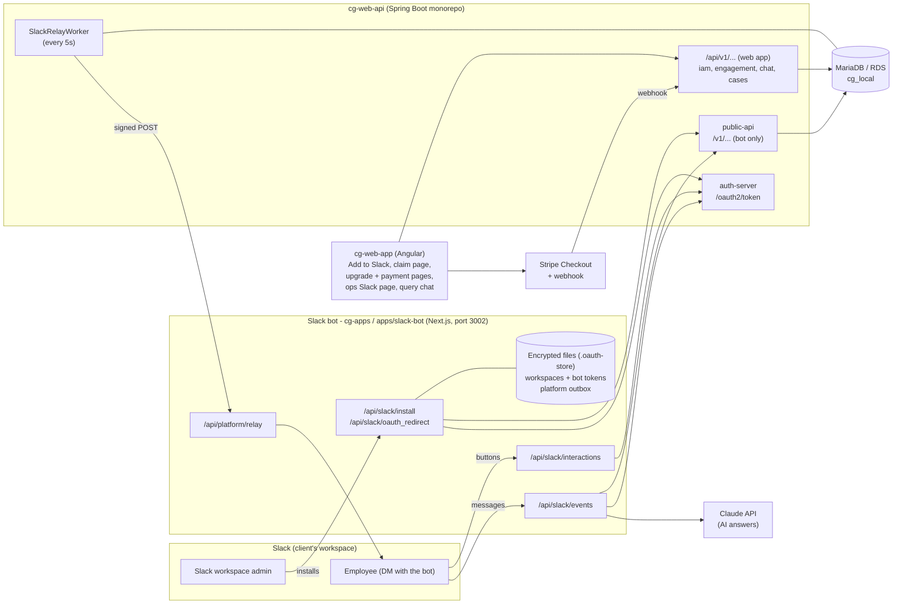
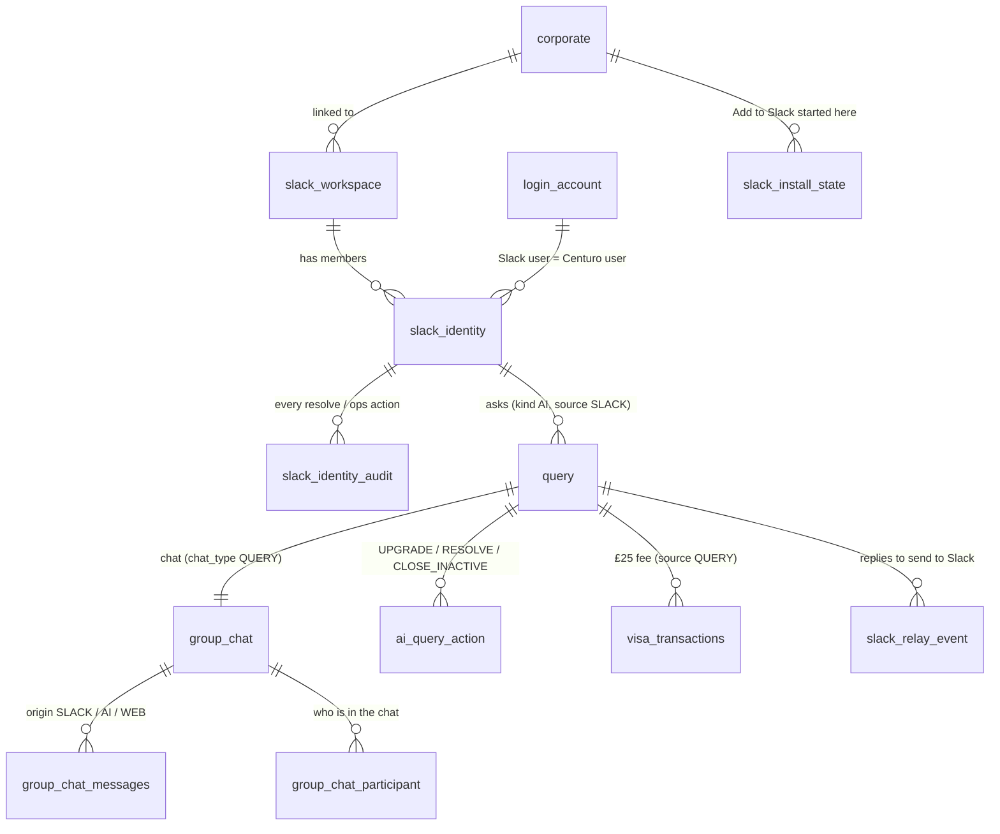
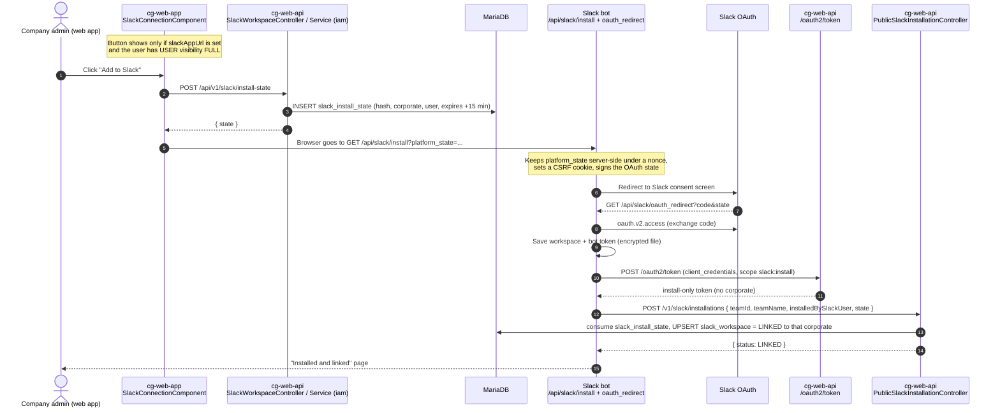
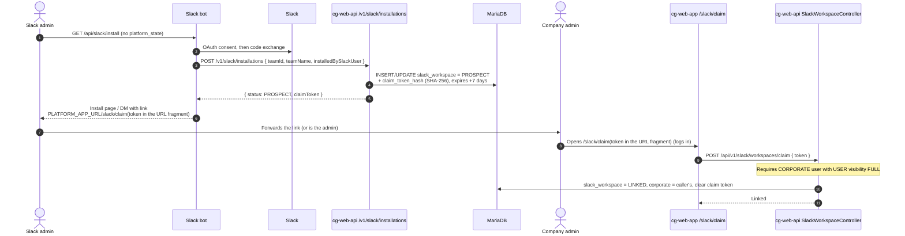
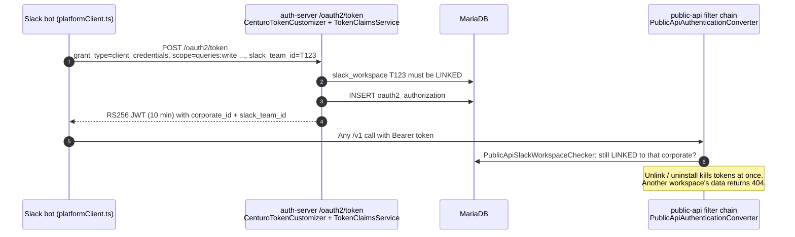
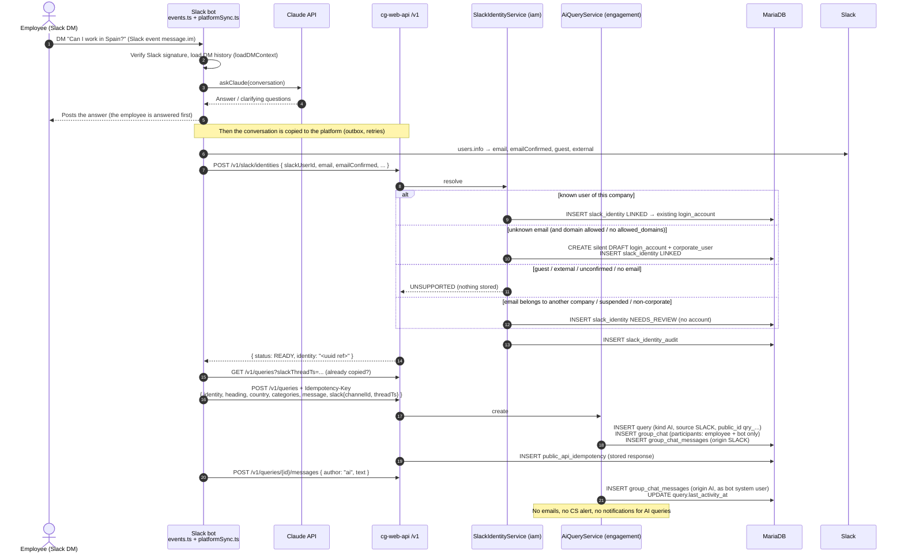
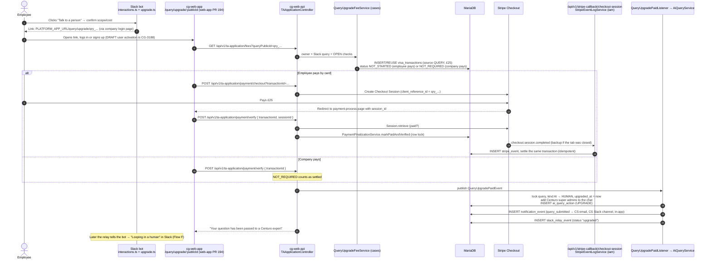
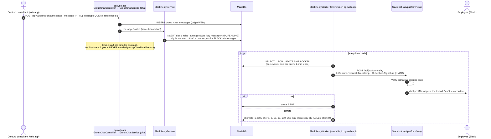
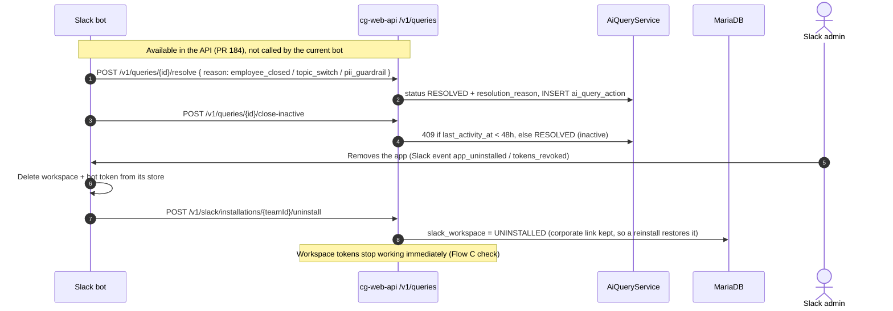

# Slack bot: how it works, end to end

This explains the whole Slack bot feature (cg-web-api stack #187, plus the bot and web-app PRs it depends on): every flow from the **"Add to Slack"** button to the expert reply arriving back in Slack. For each step it shows which API is called, which code handles it, and what gets stored where.

Section 9 then marks where each issue found in the review sits in these flows.

> The diagrams are Mermaid. They display as diagrams on GitHub, in VS Code (Markdown preview with Mermaid support) and on mermaid.live.
> Everything here was taken from the code at the top of each branch:
> - cg-web-api: `feature/CG-3179-query-escalation-payment`
> - cg-apps: `feat/slack-bot/import`
> - cg-web-app: `feature/CG-3187-slack-link`, plus `feature/CG-3179-query-escalation-payment` for the payment pages

---

## 1. The big picture

**Who talks to whom:**
- The **bot** talks to Slack and to Claude, and to cg-web-api **only through `/v1`**, using its own OAuth client (`slack-bot-service-*`).
- The **web app** uses the normal `/api/v1` with the user's web login (JWT).
- cg-web-api **never holds a Slack token**. It pushes replies to the bot (the "relay"), and the bot posts them into Slack.

### Where the code lives

| Area | Repo / module | Main classes |
|---|---|---|
| OAuth server (tokens for the bot) | cg-web-api `auth-server` | `RegisteredClientSeeder`, `CenturoTokenCustomizer`, `TokenClaimsService`, `AuthServerSecurityConfig` |
| `/v1` public API (bot-facing) | cg-web-api `public-api` | `PublicSlackInstallationController`, `PublicSlackIdentityController`, `PublicSlackWorkspaceController`, `PublicQueryController`, `PublicMeController`, `PublicApiIdempotencyService`, `PublicApiSlackWorkspaceChecker`, `PublicApiUserLoader` |
| Workspaces and identities | cg-web-api `iam` (`com.centuroglobal.slack`) | `SlackWorkspaceService`, `SlackIdentityService`, `SlackWorkspaceController`, `AdminSlackWorkspaceController`, `AdminSlackIdentityController` |
| AI queries | cg-web-api `engagement` (`aiquery`) | `AiQueryService`, `QueryUpgradePaidListener`, `QueryService` |
| Chat and relay to Slack | cg-web-api `chat` | `GroupChatService`, `GroupChatEmailService`, `SlackRelayService`, `SlackRelayWorker`, `SlackRelayClient` |
| £25 upgrade payment | cg-web-api `cases` + `iam` | `QueryUpgradeFeeService`, `TAApplicationService`, `PaymentFinalizationService`, `StripeEventLogService` (webhook) |
| The bot | cg-apps `apps/slack-bot` | `lib/slackInstall.ts`, `lib/platformClient.ts`, `lib/platformSync.ts`, `lib/platformRelay.ts`, `lib/upgrade.ts`, `lib/dmContext.ts`, `lib/claude.ts` |
| Web pages | cg-web-app | `modules/slack/*` (Add to Slack button, claim page, ops page), `modules/query/pages/query-upgrade-*` (payment, in web-app PR #194) |

---

## 2. Data model (what is stored where)

| Table | New or changed | What it holds | Written by | Repository |
|---|---|---|---|---|
| `oauth2_registered_client` | new (V1_50_0) | The bot's OAuth clients (seeded from yml at boot) | auth-server | Spring Authorization Server (JDBC) |
| `oauth2_authorization` | new | One row per issued token / code | auth-server | Spring Authorization Server (JDBC) |
| `slack_workspace` | new (V1_50_1/2) | Slack team, status `PROSPECT/LINKED/UNINSTALLED`, linked corporate, claim-token **hash**, installer | install, claim, ops link, uninstall | `SlackWorkspaceRepository` |
| `slack_install_state` | new (V1_50_2) | Single-use state from the web app's "Add to Slack" (hash, corporate, user, 15-min expiry) | Add to Slack | `SlackInstallStateRepository` |
| `slack_identity` | new (V1_50_1/3) | Slack user → Centuro `login_account`, opaque `ref`, status `LINKED/NEEDS_REVIEW` | identity resolve, ops review | `SlackIdentityRepository` |
| `slack_identity_audit` | new (V1_50_3) | Every resolution and ops action (client / user, outcome) | identity resolve, ops review | `SlackIdentityAuditRepository` |
| `login_account` + `corporate_user` | existing | Silent **DRAFT** users created for unknown emails, plus the seeded `slack-bot@system…invalid` system user | identity resolve | `LoginAccountRepository` / `CorporateUserService` |
| `query` | changed | New columns: `kind` (AI/HUMAN), `source` (SLACK/PLATFORM), `public_id` (`qry_…`), `slack_team_id`, `slack_channel_id`, `slack_thread_ts`, `last_activity_at`, `upgraded_at`, `resolution_reason` | /v1 queries, upgrade, resolve | `QueryRepository` |
| `group_chat` / `group_chat_participant` | existing | The query's chat (AI: employee + bot only; after upgrade: + Centuro super admins) | create, upgrade | `GroupChatRepository` |
| `group_chat_messages` | changed | New `origin`: `SLACK` (employee), `AI` (bot), `WEB` (platform) | every message | `GroupChatMessageRepository` |
| `public_api_idempotency` | new (V1_50_4) | Key, request hash and stored response for 24h replay | /v1 POSTs | `PublicApiIdempotencyRepository` |
| `ai_query_action` | new (V1_50_5) | Audit of UPGRADE / RESOLVE / CLOSE_INACTIVE with reason, payment ref, client | upgrade, resolve, close | `AiQueryActionRepository` |
| `visa_transactions` | existing, new source `QUERY` | The £25 fee (`reference_id` = query id), status `NOT_STARTED/PAID/NOT_REQUIRED` | fees page, checkout, verify, webhook | `VisaTransactionRepository` |
| `stripe_event` | changed (V1_50_6) | Logged Stripe webhooks (`api_version` widened) | Stripe webhook | `StripeEventRepository` |
| `slack_relay_event` | new (V1_50_7) | Outbox of replies and status changes to send to the bot (`dedupe_key`, status, attempts, next attempt) | web chat message, status change, upgrade | `SlackRelayEventRepository` |
| `notification_event` | existing | CS alert on upgrade (`query_submitted`) | upgrade | notification outbox |

**What the bot stores itself** (encrypted files under `.oauth-store`, with no database yet):
- installed workspaces and their **Slack bot tokens**
- the outbox of conversation turns not yet copied to the platform
- relay dedupe

The conversation state is read back from the **Slack DM history** (`loadDMContext`).

---

## 3. Flow A: "Add to Slack" from the web app (platform-started install)

A company admin clicks **Add to Slack** in cg-web-app. The workspace is linked to their company straight away.

---

## 4. Flow B: install straight from Slack, then claim (prospect)

Someone installs the bot without starting from Centuro (later this will be from the Slack Marketplace). The workspace becomes a **PROSPECT** until a company admin claims it.

**Ops alternative (Notion guide, option B):** Centuro ops open the **Slack workspaces** admin page:
- `GET /api/v1/admin/slack/workspaces` lists the workspaces.
- `PUT /api/v1/admin/slack/workspaces/{teamId}/corporate { corporateId }` links one to a company.
- `DELETE …/corporate` unlinks it.

All three go through `AdminSlackWorkspaceController` → `SlackWorkspaceService`, which writes the `slack_workspace` table.

*(In later PR CG-3187, company admins can list their own workspaces with `GET /api/v1/slack/workspaces`.)*

---

## 5. Flow C: every bot call gets a workspace token

Before any work for a workspace, the bot gets a short-lived token **for that workspace**.

---

## 6. Flow D: an employee messages the bot (identity + AI query)

**Ops review of stuck identities:**
- `GET /api/v1/admin/slack/identities` lists the identities waiting for review.
- `PUT /{id}/user` links one to a user.
- `DELETE /{id}` forgets it.

All three go through `AdminSlackIdentityController` → `SlackIdentityService`, which writes `slack_identity` and `slack_identity_audit`.

### Who can see an AI query (#182)

| Who | Sees the AI query? |
|---|---|
| The employee (web app, by id) | Yes |
| Company admins, the company's query lists, stats, counts, NPS, work log picker | **No**, hidden while `kind = AI` |
| Centuro admin query list | Only with `?includeAi=true` |
| Emails, digests, CS Slack channel | None while AI |
| Chat by id (`GET /api/v1/group-chat/message`) | Participants + admins only, via `checkAiQueryChatReader` (see issue #2) |

---

## 7. Flow E: "Talk to a person", the £25 expert upgrade

The bot offers "Initiate the service" or **"Talk to a person"**. Paying hands the query to Centuro.

*(The API also has `POST /v1/queries/{id}/upgrade { paymentReference: <transaction id> }`, which lets the bot upgrade directly. **The current bot doesn't call it**: it relies on the payment pages above.)*

---

## 8. Flow F: a consultant replies, and the reply reaches Slack (the relay)

**Status changes** take the same path:
- **Changed on the platform:** `PUT /api/v1/queries/{id}?status=RESOLVED` → `QueryService.updateStatus` → a `slack_relay_event` with `status:…` → the bot posts "resolved".
- **Upgrade:** it sends `upgraded`.

**The employee replies in Slack after the upgrade:**
1. Bot → `POST /v1/queries/{id}/messages {author: employee}`.
2. A `group_chat_messages` row (origin `SLACK`) is saved, and assigned staff are emailed.
3. Nothing is relayed back (no echo).

---

## 9. Flow G: closing, and uninstalling

---

## 10. Where the review issues sit in these flows

Numbers match `stack-187-review-simple.md` / `stack-187-review-summary.txt`. **R** = reproduced locally, **S** = seen in tests, **C** = from the code.

| Issue | Flow and step | What goes wrong there |
|---|---|---|
| **1. CI never passes** (C) | Build, not runtime | `ci.yml` pins Testcontainers 1.20.4 |
| **2. Chat broken for non-admins, then readable by anyone** (R) | Section 6 "who can see", and every chat read (Flow F, web chat) | `GroupChatService.checkAiQueryChatReader` crashes (lazy `participants`); underneath, there's no access check for non-AI query chats |
| **3. Paid but not handed over** (R) | Flow E, final steps (`QueryUpgradePaidListener → AiQueryService.upgradePaid`) | A closed or already-upgraded query just returns or logs; verify still says "passed to an expert" |
| **4. Bot can close a paid query** (R) | Flow G `resolve` / `close-inactive`, and Flow F (staff reply doesn't touch `last_activity_at`) | No check for `upgraded_at`. *Not reachable from the current bot, which doesn't call these endpoints, but open to any caller of the API.* |
| **5. Linked to an admin on email alone** (S) | Flow D, `POST /v1/slack/identities` "known user" branch | Trusts the bot-supplied email; no confirmation, no notice |
| **6. Install link can link the wrong company** (C) | Flow A, `slack_install_state` → `POST /v1/slack/installations` | The state isn't tied to who uses it; no confirmation step |
| **7. Duplicates / lost updates** (R) | Flow D `POST /v1/queries` (idempotency); Flows E and G (no row lock) | `public_api_idempotency` saved after the action; `query` updated without lock or version |
| **8. Reply reaches the employee by no channel** (S) | Flow F, worker → bot | Permanent errors retried and block later events; email suppressed; relay off outside dev |
| Long messages → 500 (R) | Flow D `POST /v1/queries` / `messages` | No length checks (`description` 2000) |
| Suspended company keeps working (R) | Flow C token + Flow D identity / query | Corporate status never checked on the Slack path |
| Drafts for any email, which can block a whole company (R) | Flow D "unknown email" branch | No `allowed_domains` = anyone; the domain then blocks company sign-up |
| Company-pays = free unlimited upgrades (S) | Flow E `GET /fees` → NOT_REQUIRED | Loading the fees page already counts as settled |
| Expert/partner sees the wrong company name (C) | Flow C token → `GET /v1/me` | `PublicApiUserLoader` uses the expert or partner id as `corporateId` |
| Raw Slack/AI text in the HTML chat (C) | Flow D messages → web chat view | Stored unescaped |
| Growing tables (C) | Flows C, D and F | `oauth2_authorization`, `public_api_idempotency`, `slack_relay_event` are never purged |
| Delete company/user → 500 (C) | Ops, outside these flows | New FKs from `slack_workspace` / `slack_identity`; pre-checks ignore AI queries |
| No settings outside dev (C) | Flows A, C and F | Signing key, OAuth clients, relay secret and URL only exist in `application-dev.yml` |

---

## 11. Quick reference: every endpoint in the feature

| Who calls | Endpoint | Purpose | Handler |
|---|---|---|---|
| Bot | `POST /oauth2/token` | Install-only or workspace token | auth-server |
| Bot | `POST /v1/slack/installations` | Report install (PROSPECT, or LINKED with state) | `PublicSlackInstallationController` |
| Bot | `POST /v1/slack/installations/{teamId}/uninstall` | Report uninstall | `PublicSlackInstallationController` |
| Bot | `GET /v1/slack/workspaces/{teamId}` | Workspace + company name | `PublicSlackWorkspaceController` |
| Bot | `POST /v1/slack/identities` | Slack user → Centuro user | `PublicSlackIdentityController` |
| Bot | `POST /v1/queries`, `GET /v1/queries`, `GET /v1/queries/{id}` | Create / find AI queries | `PublicQueryController` |
| Bot | `POST` / `GET /v1/queries/{id}/messages` | Add / read messages | `PublicQueryController` |
| Bot (not used yet) | `POST /v1/queries/{id}/upgrade`, `/resolve`, `/close-inactive` | Actions | `PublicQueryController` |
| Bot / any client | `GET /v1/me`, `GET /v1/case-types` | Foundation endpoints | `PublicMeController`, `PublicCaseTypeController` |
| Web app | `POST /api/v1/slack/install-state` | Start Add to Slack | `SlackWorkspaceController` |
| Web app | `POST /api/v1/slack/workspaces/claim` | Claim a prospect | `SlackWorkspaceController` |
| Web app (ops) | `GET /api/v1/admin/slack/workspaces`, `PUT` / `DELETE …/{teamId}/corporate` | Ops link / unlink | `AdminSlackWorkspaceController` |
| Web app (ops) | `GET /api/v1/admin/slack/identities`, `PUT /{id}/user`, `DELETE /{id}` | Identity review | `AdminSlackIdentityController` |
| Web app (ops) | `GET /api/v1/admin/queries?includeAi=true` | See AI queries | `AdminQueryController` |
| Web app | `GET /api/v1/ta-application/fees?queryPublicId=` | £25 fee for a Slack query | `TAApplicationController` → `QueryUpgradeFeeService` |
| Web app | `POST /api/v1/ta-application/payment/checkout`, `/payment/verify` | Pay / confirm | `TAApplicationController` |
| Stripe | `POST /api/v1/stripe-callback/checkout-session` | Webhook backup | `StripeCallbackController` → `StripeEventLogService` |
| Web app | `POST` / `GET /api/v1/group-chat/message` | Chat (feeds the relay) | `GroupChatController` |
| cg-web-api → bot | `POST {relay url}/api/platform/relay` | Replies and status to Slack | `SlackRelayWorker` → bot `platformRelay.ts` |
